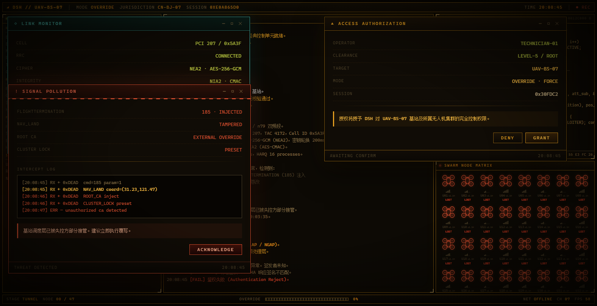
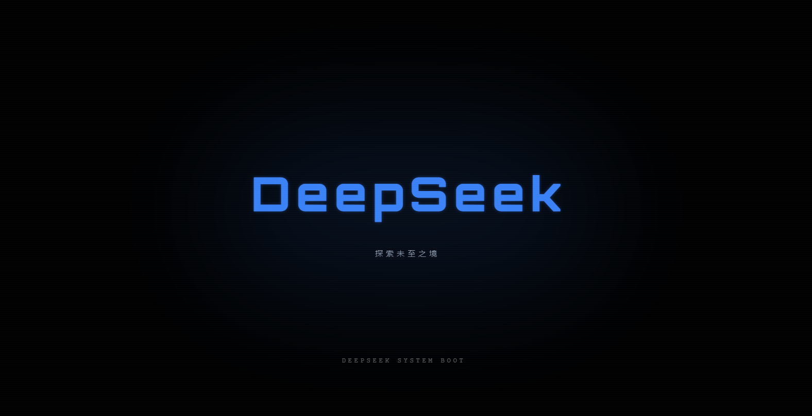
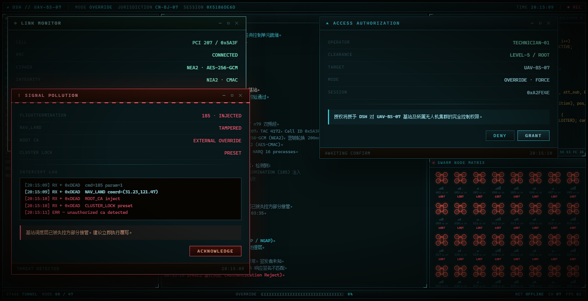

# dsh-boot-deepseek

[中文](README.md) | [English](README.en.md)

[](LICENSE)
[](https://github.com/Yuanqingyuang/dsh-boot-deepseek/stargazers)
[](https://github.com/Yuanqingyuang/dsh-boot-deepseek/commits/main)
[](https://github.com/topics/dsh-plugin)

**给 DeepSeek Harness（DSH）加一段 DSH 开机片头。**
每次启动客户端全屏播放，播完渐出，露出真正的界面。*Full-screen DSH boot intro for DeepSeek Harness.*

动画与 HTML 原稿由 **Voidpocket**（[@Voidpoket](https://github.com/Voidpocket)）提供，插件工程与移植由
**Ziyang Song**（[@yannicksong0106](https://github.com/yannicksong0106)）完成。详见 [CREDITS.md](CREDITS.md)。

> **本仓库是 [yannicksong0106/dsh-550c-boot](https://github.com/yannicksong0106/dsh-550c-boot) 的定制分支（fork）。**
> 上游的插件工程、动画移植、文档与验证脚手架全部保留并按其原样署名；本分支只改品牌与片尾。
> 包名仍叫 `dsh-550c-boot`——它同时是 localStorage 键、路由前缀与插件入口 id，改名会破坏已装好的 profile。

> **本分支改了什么**
>
> - **开头换成「自我书写」**（移植自参考页 `index-scifi-futuristic`）：每个字母的**轮廓自己画出来**
>   （`stroke-dashoffset` 归零），填充在 0.12 s 后追上来并带蓝色辉光，8 个字母每 0.10 s 一个；
>   字标整体品牌蓝 `#3b82f6`，下方是 HUD 铭牌样式的「探索未至之境」，背后一层低饱和蓝色雾霭。
>   字幕仍是 `DEEPSEEK SYSTEM BOOT`。字标用 **Orbitron**（OFL 1.1，构建时内联进 bundle，
>   许可全文见 `assets/orbitron-OFL.txt`），字形与参考页一致。
> - 片内**所有 `550C` 文案改为 `DSH`**：终端说话人标签、HUD 品牌、固件清单里的 `CA_DSH_ROOT`、
>   操作者提示等共 77 处，写在 `scripts/extract.mjs` 的第 13 条定点改写里（带数量断言）。
> - **完整档**在 `SYSTEM IS REWRITTEN` 之后追加播放 `lib/media/intro.mp4`（DeepSeek 赛博片头，
>   7.05 s / **3840×2160** / H.264+AAC，静音自动播放），由宿主半边经同源路由
>   `/dsh-550c-boot/media/intro.mp4` 送出（支持 Range）。完整档因此约 18 s；简易档约 3 s。
> - 版本号 `0.4.0-deepseek.1`：故意高于 npm 上的 `0.3.3`，避免设置里的「检查更新 → 立即更新」
>   把这份定制覆盖回上游原版。
> - 改动全部落在 `scripts/extract.mjs` 的定点改写里（第 9–13 条，每条都写了原因），
>   `npm run build` 可复现；`scripts/test-host.mjs` 覆盖媒体路由的 200/206/416/404/405 行为。
> - `lib/media/intro.mp4` 是 **Steam 创意工坊第三方作品**（《4K120FPS-DeepSeek专业工作模式》）
>   的副本，版权归原作者；本仓库只是个人定制的留档，仓库里其余代码仍是上游的 MIT 许可。



- 🎬 **两个档位**：简易档约 3 秒（字标自我书写）/ 完整档约 18 秒（覆写全流程）+ 片尾视频，可一键关闭
- ⏭️ **随时跳过**：点击画面或按 `Esc`
- 🖥️ **盖住 DSH 自己的开机卡片**：首帧由宿主半边在文档解析阶段注入，`HARNESS / Loading plugins…` 不会再露脸
- 🎨 **四套磷光配色**，默认是原作者的琥珀；桌面窗口右上角那三个原生按钮会被收编成同一套颜色

## 安装

```sh
# 从本仓库安装（仓库带构建产物，无安装期脚本）
dsh plugin --profile <profile> add github:Yuanqingyuang/dsh-boot-deepseek

# 或从本地目录安装
dsh plugin --profile <profile> add <本目录绝对路径>
```

> **桌面客户端**（`desktop` profile）由 Electron 应用独占管理，`dsh plugin` 会直接拒绝这个 profile：
> 请在 **设置 → 插件** 里安装，或先用上面的本地目录方式装好再重启客户端。

装完**必须重启一次 DSH**（bundle 在启动时装配）。升级或重装后请按 **Ctrl+Shift+R** 硬刷新——
DSH 的客户端 bundle 带 `max-age=31536000, immutable`，而 URL 上的 `rev` 是进程 nonce、不随内容变化，
普通 F5 会一直用第一次抓到的副本。

## 使用

模式开关在 **设置 → 通用 → DeepSeek 开机动画**，旁边有「预览」按钮可以立刻看一遍。

| 档位 | 时长 | 内容 |
|---|---|---|
| **简易**（默认） | ~3 秒 | DeepSeek 字标自我书写 |
| **完整** | ~18 秒 | 字标 → 基站接管终端 → 47 节点逐点覆写 → `SYSTEM IS REWRITTEN` → 片尾视频 |
| **关闭** | — | 不播放，一张黑屏都不会出现 |

- 动画**播完才渐出**，不等软件加载状态；无论 DSH 是否早已就绪都会完整播完
- 完整档下**点击画面或按 `Esc`** 跳过
- 偏好存在浏览器 `localStorage`（键 `dsh-550c-boot:mode`），与已装的第三方设置行做法一致
- 每次客户端加载都会播（刷新页面也算）；「每个会话只播一次」需要额外去重，目前故意不做
- 片头播放期间，桌面窗口右上角那几个原生按钮**浮在动画上**（条带透明、符号用当前配色），
  窗口顶部 40px 仍可拖动窗口；片头结束自动还原
- **零运行时依赖**：`dependencies` 是空的，宿主半边只用 `node:fs`

### 版本与更新

DSH 自身没有插件更新入口，所以通用设置里多了一行 **版本与更新**：

- **检查更新**：向本机宿主查询 npm 上的最新版本。宿主先打**国内镜像** `registry.npmmirror.com`，
  失败再退官方源，响应里带上来源（实测这台机器镜像 160ms、官方 2078ms）；缓存 5 分钟，
  两个源都问不到就直说问不到。只有按下按钮才会联网。
- **立即更新**（`web` 等 profile）：由宿主调用 DSH CLI 执行
  `plugin --profile <当前 profile> add dsh-550c-boot@latest` —— 唯一受支持的改 profile 方式 ——
  把 CLI 输出原样回报，然后提示重启客户端生效。
- **桌面端走提示词**：`dsh plugin` 硬编码拒绝 `desktop`（Electron 应用独占管理该 profile），
  所以那里不给「立即更新」，而是显示「在 设置 → 插件 里安装 `dsh-550c-boot@latest`，然后重启」
  加一个复制包名按钮。

两个请求都走宿主半边的同源路由（`GET /dsh-550c-boot/update`、`POST /dsh-550c-boot/update/apply`）：
页面 CSP 很紧，而宿主进程本来就管出网。

### 配色

| 方案 | 说明 |
|---|---|
| **琥珀**（默认） | 原作者的 CRT 配色，一个 token 都不覆盖 |
| 绿 | P1 绿磷光终端 |
| 青 | 冷青磷光 |
| 白 | P4 白/灰磷光 |

「琥珀」故意没有对应的 CSS 块：选它会把 `data-scheme` 整个清掉，默认值重新接管。




## 兼容与限制

- **DSH 版本要求 `>=0.2.0-rc.1`**（`package.json#dsh.engines`）。宿主半边依赖 `webserver/index-inject`
  的行渲染行为，我只在 `0.2.0-rc.1` 上实测过，不声明没验过的下限。在更低的宿主（如 `0.1.7-rc.2`）上
  安装能过，但之后的应用内更新会被以 412 拒掉；需要 `0.1.7` 支持可以提 issue。
- 只能在 **Web UI 加载之后**覆盖全屏，做不到早于 Electron 窗口首帧（窗口本身仍有一瞬间空白）。
- 首帧是一块**纯色**（动画自己的底色），不是动画的第一帧画面——它只负责在插件求值前占住屏幕。
- 桌面窗口的原生按钮仍在，只是被改成同一套配色；要去掉得改桌面壳。
- macOS 上片头播放期间，顶部条带归窗口拖动，点击跳过请点别处或按 `Esc`。

## 文档

| 文档 | 内容 |
|---|---|
| [docs/ARCHITECTURE.md](docs/ARCHITECTURE.md) | 工程结构、为什么是「提取」而不是重写、启动时序与首帧注入策略 |
| [docs/ENHANCEMENTS.md](docs/ENHANCEMENTS.md) | 内容增强层：等宽字体、字符单元进度条、真实时钟戳、固件页脚与 CRC32 |
| [docs/DESKTOP-CHROME.md](docs/DESKTOP-CHROME.md) | 桌面标题栏三个按钮的让位与换色、macOS 拖拽守卫 |
| [docs/VERIFICATION.md](docs/VERIFICATION.md) | 构建与验证：harness 探针、真实 GUI 的 CDP 截图断言 |
| [docs/PUBLISHING.md](docs/PUBLISHING.md) | 发布与收录：GitHub 直装 / OMDSH Hub 投稿 / npm |
| [docs/PLAN-macos-and-update-check.md](docs/PLAN-macos-and-update-check.md) | 评估稿：macOS 适配待办、设置里的「检查更新」方案对比 |

> 顶部徽章都是外部图片（shields.io / 第三方访客计数器），加载不出来不影响 README 本身。

## 致谢

动画与 HTML 原稿由 **Voidpocket**（[@Voidpoket](https://github.com/Voidpocket)）提供，插件工程与移植由
**Ziyang Song**（[@yannicksong0106](https://github.com/yannicksong0106)）完成。详见 [CREDITS.md](CREDITS.md)。

[MIT](LICENSE) © 2026 Ziyang Song
